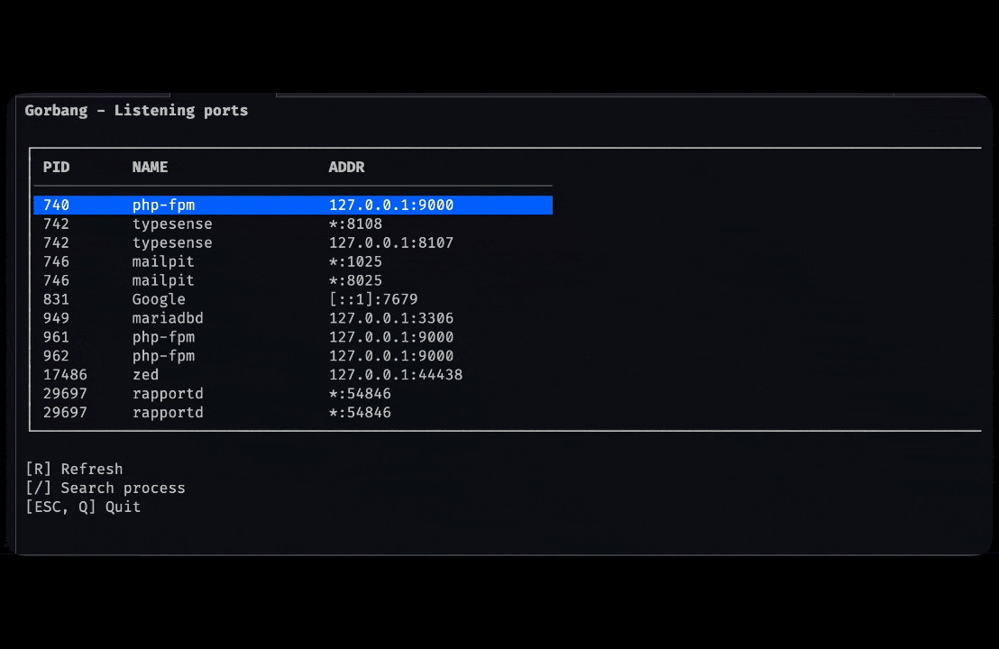

<p align="center">
  
</p>

# Gorbang

The name **Gorbang** comes from the Indonesian word **"gerbang"**, meaning
**gate** or **port** — a fitting name for a tool that stands watch over
everything passing through the ports on your machine.

Gorbang is a fast terminal UI for finding and killing processes that are listening
on TCP ports. It reads `lsof` output and shows every listening socket in a
searchable table with its PID, process name, and bound address — so you can track
down that "port already in use" process and kill it without leaving the terminal.



## Features

- List all TCP ports in `LISTEN` state
- Columns: PID, process name, bound address
- Fuzzy search across PID / name / address (`/`)
- Kill a process with a `y`/`enter` confirmation prompt
- Refresh the list (`r`) without restarting

## Installation

### Homebrew

```sh
brew install nnivxix/tap/gorbang
```

or

```sh
brew tap nnivxix/tap
brew install gorbang
```

### Build from source

Prerequisites: Go 1.27+ and `lsof` (preinstalled on macOS and most Linux distros).

```sh
git clone https://github.com/nnivxix/gorbang.git
cd gorbang
go build -o gorbang .
mv gorbang /usr/local/bin/     # or ~/.local/bin, ~/go/bin, etc.
```

Or run it without building:

```sh
go run .
```

> Note: `lsof` may require elevated privileges to show ports owned by other users.
> Run with `sudo` if some entries are missing.

## Usage

```sh
gorbang
```

| Key         | Action                            |
| ----------- | --------------------------------- |
| `/`         | Enter search mode                 |
| `esc`       | Exit search mode / quit           |
| `up` / `k`  | Move selection up                 |
| `down` / `j`| Move selection down               |
| `enter`     | Arm kill for the selected process |
| `y`         | Confirm the kill                  |
| `r`         | Refresh the process list          |
| `q`         | Quit                              |
| `c`         | View Changelog                    |

Search mode matches on PID, process name, and address. Press `esc` to clear the
query and return to full list navigation.

## Update

```sh
brew upgrade gorbang
```

if error

```sh
brew tap nnivxix/tap
brew upgrade gorbang
```

## License

[MIT](LICENSE)
